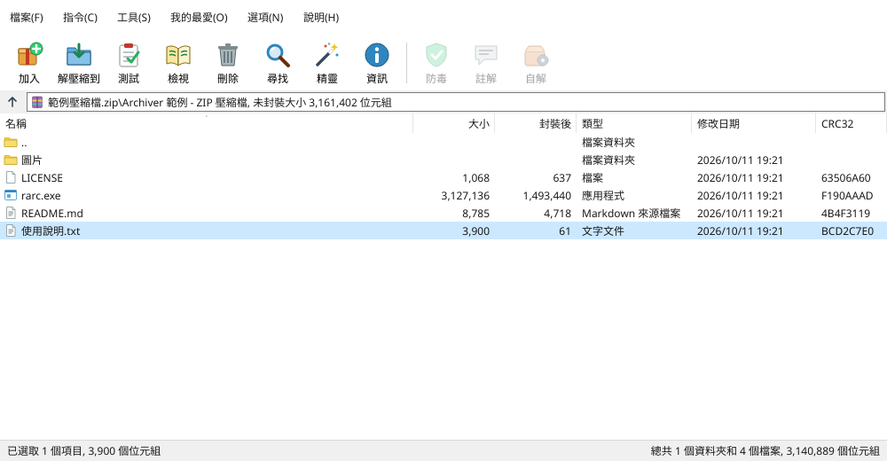

# Archiver

跨平台（Windows / Linux / macOS）的壓縮／解壓縮工具，類似 WinRAR。核心與 GUI 皆以 Rust 撰寫（GUI 使用 egui/eframe）。



## 功能

- 開啟壓縮檔並列出內容（名稱、大小、壓縮後大小、修改時間），支援搜尋過濾
- 全部解壓縮或只解壓縮選取的檔案／資料夾（Ctrl/Shift 多選）
- 從檔案或資料夾建立壓縮檔，可選擇格式與壓縮等級
- ZIP / 7z 密碼（AES-256）加密與解密，RAR 密碼解壓
- 背景執行緒處理，進度條與取消按鈕
- 拖放：拖入壓縮檔即開啟，拖入一般檔案／資料夾即建立壓縮檔
- 防止 zip-slip 路徑穿越攻擊
- 附帶命令列工具 `rarc`
- 右鍵選單整合：Windows 檔案總管、Linux（Nautilus / Dolphin / Nemo）、macOS Finder 快速動作

## 右鍵選單整合

在 GUI 按「⚙ 右鍵選單 Shell menu」勾選啟用，或在終端機執行：

```bash
archiver --register-shell     # 安裝（僅目前使用者，不需系統管理員）
archiver --unregister-shell   # 移除
```

> 註冊時會記錄程式目前的路徑，搬移程式後請重新註冊。
>
> 本專案原名 Rust Archiver（v0.2.0 以前）。執行 `archiver --register-shell` 會自動移除舊版「Rust Archiver」的右鍵選單項目，避免重複。

| 系統 | 安裝內容 | 選單項目 |
|---|---|---|
| Windows | `HKCU\Software\Classes` 下的串接子選單：壓縮檔（`SystemFileAssociations\.zip` 等）、所有檔案（`*`）、資料夾（`Directory`） | 壓縮檔：開啟、解壓到這裡、解壓到資料夾\、加入壓縮檔…；其他檔案與資料夾：加入壓縮檔… |
| Linux | `~/.local/share/applications/archiver.desktop`（MIME 關聯 → 「以其他程式開啟」）、Nautilus 腳本（右鍵 → 腳本 → Archiver）、Dolphin 服務選單（KF6 `kio/servicemenus` 與 KF5 `kservices5/ServiceMenus`）、Nemo actions | 同上 |
| macOS | `~/Library/Services/Archiver - *.workflow` 四個快速動作 | Finder 右鍵 → 快速動作（或「服務」）→ Archiver - … |

macOS：若快速動作沒有出現，到「系統設定 → 一般 → 登入項目與延伸功能 → Finder（或 鍵盤 → 鍵盤快速鍵 → 服務）」勾選。建議先把 `Archiver.app` 放到「應用程式」資料夾再註冊。

### 命令列參數（供右鍵選單使用）

```
archiver <壓縮檔>                     開啟
archiver --open <壓縮檔>
archiver --extract-here <壓縮檔...>     解壓到壓縮檔所在資料夾，成功後自動關閉
archiver --extract-to-folder <壓縮檔...> 解壓到「壓縮檔名稱」子資料夾
archiver --compress <檔案/資料夾...>     開啟建立壓縮檔視窗並預先填入
```

解壓失敗（例如需要密碼）時會改為開啟該壓縮檔，輸入密碼後再解壓。

## 支援格式

| 格式 | 建立 | 解壓 | 密碼 | 壓縮等級 |
|------|:---:|:---:|:---:|:---:|
| ZIP (Deflate) | ✅ | ✅ (Deflate/Deflate64/BZip2/LZMA/XZ/Zstd/PPMd) | ✅ AES-256（解壓也支援 ZipCrypto） | 0–9 |
| 7z (LZMA2) | ✅ | ✅ | ✅ AES-256（含標頭加密） | 0–9 |
| TAR | ✅ | ✅ | — | — |
| TAR.GZ / TGZ | ✅ | ✅ | — | 0–9 |
| TAR.BZ2 / TBZ2 | ✅ | ✅ | — | 1–9 |
| TAR.XZ / TXZ | ✅ | ✅ | — | 0–9 |
| TAR.ZST / TZST | ✅ | ✅ | — | 1–22 |
| GZ / BZ2 / XZ / ZST（單一檔案） | ✅ | ✅ | — | 同上 |
| RAR (v4 / v5) | ❌ | ✅ | ✅ | — |

> **為什麼不能建立 RAR？** RAR 壓縮演算法為 RARLAB 的專有格式，官方 UnRAR 原始碼授權只允許解壓縮，明文禁止用來重建 RAR 壓縮器，因此本程式只能解壓 RAR。

## 下載

到 [Releases](https://github.com/stevenke1981/archiver/releases) 下載對應平台的檔案：

- Windows：`archiver-windows-x64.zip`
- Linux：`archiver-linux-x64.tar.gz`（需 GTK3 執行環境供檔案對話框使用）
- macOS：`archiver-macos-universal-app.zip`（`Archiver.app`，Apple Silicon + Intel 通用版，宣告了壓縮檔文件類型，可用「打開檔案的應用程式」）；`archiver-macos-universal.tar.gz` 為單純執行檔。未經公證，首次開啟請按右鍵 → 打開，或在「系統設定 → 隱私權與安全性」允許

## 從原始碼建置

```bash
# Linux 需先安裝：
sudo apt install build-essential pkg-config libgtk-3-dev libxkbcommon-dev libgl1-mesa-dev libwayland-dev
cargo build --release
cargo test
./target/release/archiver [壓縮檔]
```

## 命令列 `rarc`

```bash
rarc l archive.7z -p 密碼          # 列出內容
rarc x archive.rar -o 輸出資料夾     # 解壓（可在後面列出指定項目）
rarc c out.tar.zst 資料夾 檔案 -l 19  # 建立（格式依副檔名決定）
```

## 效能

v0.4.0 起使用多執行緒：xz（liblzma MT）、zstd（zstdmt）、7z（固實 + 多執行緒 LZMA2 壓縮與解壓）、平行 ZIP（各檔案分組平行壓縮後直接合併）、平行 gzip（4 MiB 區塊、標準多成員 gzip）。
以約 490 MB 混合資料、8 核心測試：7z 壓縮 292 秒 → 46 秒、tar.xz 285 → 41 秒、zip 10.5 → 2.4 秒、tar.gz 9.4 → 1.6 秒；詳見 [bench/README.md](bench/README.md)。
多執行緒 7z / xz 壓縮時記憶體用量較高（約 1.2–1.4 GB）；可用環境變數 `ARCHIVER_THREADS=2` 限制執行緒數。

## 專案結構

- `core/` — `archiver-core` 函式庫：格式偵測、列出、解壓、建立
- `gui/` — `archiver` GUI 程式與 `rarc` CLI

## 已知限制

- RAR 僅能解壓（授權限制）；RAR 解壓使用 `unrar` crate（內含 C++ UnRAR 原始碼，建置時需 C++ 編譯器）
- 不支援分卷壓縮檔的建立；7z 分卷與自解壓檔（SFX）尚未支援
- 不支援直接在壓縮檔內新增／刪除檔案（需重新建立）
- 單一檔案格式（.gz/.bz2/.xz/.zst）一次只能壓縮一個檔案，多檔請用 TAR.* 格式
- Windows 右鍵選單：選取多個檔案時，Windows 會對每個檔案各啟動一次程式（「加入壓縮檔」會開多個視窗）；Windows 11 需點「顯示更多選項」才看得到（傳統選單），「解壓到資料夾\」無法動態顯示壓縮檔名稱
- macOS「打開檔案的應用程式」/ 雙擊：檔案是以 Apple Event 傳遞，目前 eframe/winit 未提供此事件，所以 App 會啟動但不會自動載入檔案；請改用 Finder 快速動作或拖放到視窗
- 快速動作與 Linux 檔案管理員整合僅以產生檔案與格式驗證測試，未在實際桌面上點擊測試

## License

MIT

---

## English summary

**Archiver** is a WinRAR-like, cross-platform (Windows/Linux/macOS) archive manager with a Rust core library and an egui GUI.
It can open and list archives, extract all or selected entries, and create ZIP, 7z, TAR, TAR.GZ/BZ2/XZ/ZST and single-file GZ/BZ2/XZ/ZST archives with selectable compression level.
ZIP and 7z support AES-256 passwords; RAR (v4/v5) is **extract-only** because the RAR compression format is proprietary and the UnRAR license forbids re-creating a RAR compressor.
Work runs on a background thread with a progress bar and cancel button; drag-and-drop opens archives or adds files to a new archive.
A small CLI (`rarc`) is included.

*Formerly "Rust Archiver" (≤ v0.2.0); the GUI binary is now `archiver`. `--register-shell` also removes the old "Rust Archiver" menu entries so you don't get duplicates.*

**Performance (v0.4.0):** multi-threaded xz, zstd, 7z (solid, MT LZMA2 encode/decode), parallel ZIP entry compression and parallel multi-member gzip, larger I/O buffers, fat LTO. On a ~490 MB mixed set with 8 cores: 7z create 292 s → 46 s, tar.xz 285 s → 41 s, zip 10.5 s → 2.4 s, tar.gz 9.4 s → 1.6 s (see `bench/`). Multi-threaded 7z/xz use ~1.2–1.4 GB RAM; set `ARCHIVER_THREADS` to limit.

**Context-menu integration** (`archiver --register-shell`, `--unregister-shell`, or the "⚙ Shell menu" toggle in the GUI; current user only, no admin):
Windows Explorer cascading "Archiver" submenu via HKCU registry (Open / Extract here / Extract to folder\ / Add to archive… for archives; Add to archive… for other files and folders);
Linux `.desktop` MIME associations plus Nautilus scripts, Dolphin service menus and Nemo actions;
macOS Finder Quick Actions in `~/Library/Services`. The app accepts `--open`, `--extract-here`, `--extract-to-folder` and `--compress` with multiple files.
The macOS release ships a universal (arm64 + x86_64) `Archiver.app` with archive document types declared. Limitations: Windows launches one process per selected file; macOS "Open With" launches the app but the file is not loaded (Apple Events are not exposed by eframe) — use the Quick Actions or drag-and-drop. Prebuilt binaries are on the Releases page. Licensed under MIT.
